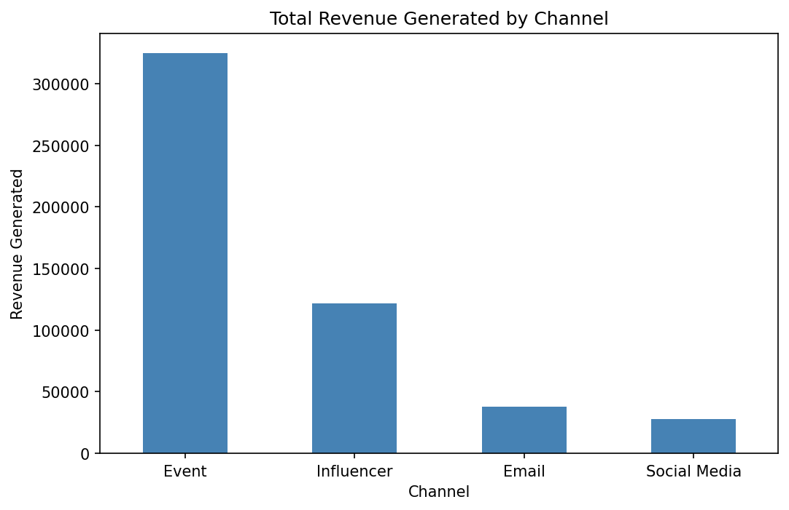
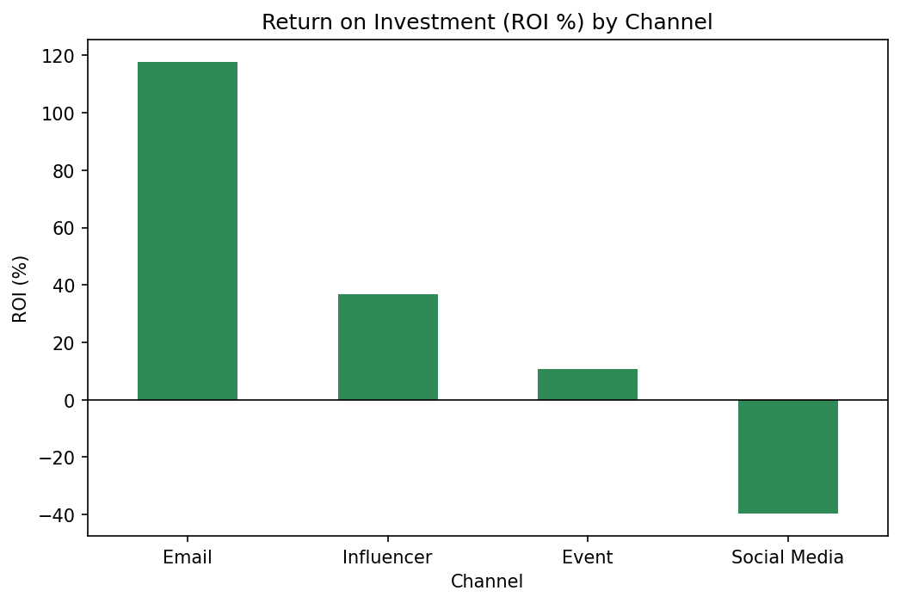
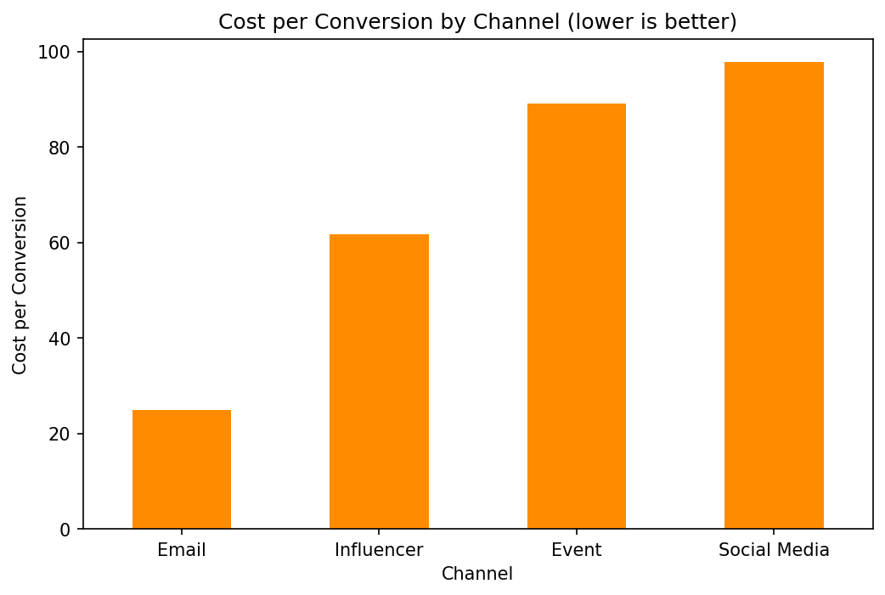

# GlowUp Campaign Performance Analysis


**An exploratory data analysis of GlowUp's marketing campaigns to measure channel efficiency and guide budget allocation.**
Analyzes spend, revenue, conversions and engagement across 30 campaigns and 4 marketing channels using ROI, cost per conversion and funnel KPIs.

---

## Table of Contents
- [About the Project](#about-the-project)
- [Problem Statement](#problem-statement)
- [Dataset](#dataset)
- [Project Structure](#project-structure)
- [Methodology](#methodology)
- [Key Findings](#key-findings)
- [Key Code Snippets](#key-code-snippets)
- [Conclusion](#conclusion)
- [Limitations](#limitations)
- [Future Scope](#future-scope)
- [How to Run](#how-to-run)
- [Tech Stack](#tech-stack)
- [Author](#author)

---

## About the Project
GlowUp invests in marketing campaigns across **Email, Influencer, Event and Social Media** channels.
Revenue alone doesn't show which channels are actually worth the money, so this project evaluates every channel on **return, cost and conversion efficiency**.

The project demonstrates:
- **Data cleaning** with reusable Python functions (`src/data_cleaning.py`)
- **KPI engineering**: ROI, profit, cost per conversion, CTR and conversion rate
- **Channel-level comparison** using grouped aggregations
- **Data-driven recommendations** for budget allocation

---

## Problem Statement
The project answers four business questions:
1. Which marketing channel generates the most revenue?
2. Which channel gives the **best return on investment (ROI)**?
3. How much does it cost to acquire one conversion through each channel?
4. Where should the marketing budget be increased or reduced?

---

## Dataset

| Property | Details |
|---|---|
| File | `data/glowup_campaigns.csv` |
| Records | 30 campaigns |
| Features | 11 columns |
| Channels | Email, Influencer, Event, Social Media |

**Data Dictionary**

| Column | Description |
|---|---|
| `CampaignID` | Unique campaign identifier |
| `CampaignName` | Name of the campaign |
| `StartDate` / `EndDate` | Campaign start and end dates |
| `Channel` | Marketing channel used |
| `Spend` | Amount spent on the campaign |
| `LeadsGenerated` | Number of leads captured |
| `Conversions` | Number of leads that converted to customers |
| `RevenueGenerated` | Revenue earned from the campaign |
| `Clicks` | Total clicks received |
| `Impressions` | Total times the campaign was shown |

---

## Project Structure
```
glowup-campaign-analysis/
├── data/
│   └── glowup_campaigns.csv                  # Raw campaign dataset
├── notebooks/
│   └── GlowUp_EDA.ipynb                      # EDA, KPI calculation and charts
├── src/
│   └── data_cleaning.py                      # Functions to load and clean the data
├── images/
│   ├── revenue_by_channel.png                # Chart 1
│   ├── roi_by_channel.png                    # Chart 2
│   └── cost_per_conversion_by_channel.png    # Chart 3
├── requirements.txt                          # Python dependencies
├── .gitignore
└── README.md
```

---

## Methodology

### 1. Data Loading and Cleaning
- Loaded the dataset with `pandas`
- Removed duplicate records
- Filled missing values to keep aggregations consistent

### 2. KPI Engineering

| KPI | Formula | Why it matters |
|---|---|---|
| Profit | `RevenueGenerated − Spend` | Actual money earned |
| ROI (%) | `(Revenue − Spend) / Spend × 100` | Return for every unit spent |
| Cost per Conversion | `Spend / Conversions` | Cost to acquire one customer |
| CTR (%) | `Clicks / Impressions × 100` | How engaging the ad is |
| Conversion Rate (%) | `Conversions / Clicks × 100` | How well clicks turn into customers |

### 3. Visualization
Channel-level bar charts built with Matplotlib and saved to `images/` for reporting.

---

## Key Findings

### Key Metrics Summary

| Metric | Value |
|---|---|
| Total Spend | ₹4,45,664 |
| Total Revenue | ₹5,11,854 |
| Total Profit | ₹66,189 |
| Overall ROI | **14.9%** |
| Total Conversions | 5,903 |
| Average Cost per Conversion | ₹75.50 |

### Channel Performance

| Channel | Spend | Revenue | Profit | ROI | Conversions | Cost / Conversion | CTR | Conv. Rate |
|---|---|---|---|---|---|---|---|---|
| Email | 17,333 | 37,742 | 20,410 | **117.8%** | 698 | **24.83** | 4.03% | 6.60% |
| Influencer | 88,922 | 1,21,501 | **32,578** | 36.6% | 1,440 | 61.75 | 3.07% | 5.23% |
| Event | 2,93,361 | 3,24,790 | 31,429 | 10.7% | 3,294 | 89.06 | N/A* | N/A* |
| Social Media | 46,049 | 27,821 | **−18,228** | **−39.6%** | 471 | 97.77 | 1.62% | 1.78% |

<sub>*Event campaigns have no impression or click data recorded.</sub>

### 1. Revenue by Channel


**Insight:** Events bring in the most revenue (63% of the total), but they also take 66% of the entire budget. Their high revenue comes from high spending, not from efficiency.

### 2. ROI by Channel


**Insight:** Email returns **₹2.18 for every ₹1 spent (117.8% ROI)** while using only 4% of the budget. Social Media is the only loss-making channel, with **−39.6% ROI** and a ₹18,228 loss.

### 3. Cost per Conversion by Channel


**Insight:** An Email conversion costs **₹24.83**, about **4× cheaper** than Social Media (₹97.77). Social Media had the largest reach (16.4 lakh impressions) but the weakest conversion rate (1.78%), so its audience isn't turning into customers.

---

## Key Code Snippets

**Load and clean the data**
```python
from src.data_cleaning import load_data, clean_data

df = load_data("data/glowup_campaigns.csv")
df = clean_data(df)
```

**ROI by channel**
```python
channel_summary = df.groupby("Channel")[["Spend", "RevenueGenerated"]].sum()
channel_summary["ROI_%"] = (
    (channel_summary["RevenueGenerated"] - channel_summary["Spend"])
    / channel_summary["Spend"] * 100
)
```

**Cost per conversion**
```python
cost = df.groupby("Channel")[["Spend", "Conversions"]].sum()
cost["Cost_per_Conversion"] = cost["Spend"] / cost["Conversions"]
```

---

## Conclusion
GlowUp's campaigns were profitable overall (**14.9% ROI**), but performance varies widely by channel:

- **Email** is the most efficient channel, with the highest ROI and the cheapest conversions, yet it receives the smallest budget.
- **Influencer** campaigns earn the **highest absolute profit** with strong, steady returns.
- **Events** drive volume but at a low return on a very large budget.
- **Social Media** is losing money and converting poorly.

**Recommendation:** shift budget toward Email and Influencer campaigns, renegotiate or optimize Event costs, and pause or redesign Social Media campaigns until they become profitable.

---

## Limitations
- **Small sample:** only 30 campaigns, so results may change with more data.
- **Missing tracking:** Event campaigns have no impression or click data, so funnel metrics can't be compared for that channel.
- **Attribution:** revenue is assigned to one channel per campaign, while real customers may interact with several channels.
- **No time analysis yet:** seasonal effects were not studied.

---

## Future Scope
- **Time-based analysis** using `StartDate` and `EndDate` to find the best months and campaign durations
- **Lead funnel analysis** using `LeadsGenerated` (lead → conversion rate per channel)
- **Budget optimization model** to recommend the ideal spend mix across channels
- **Predictive model** to forecast campaign revenue before launch
- **Interactive dashboard** in Power BI or Streamlit for the marketing team

---

## How to Run

**1. Clone the repository**
```bash
git clone https://github.com/Bhagyashree998/glowup-campaign-analysis.git
cd glowup-campaign-analysis
```

**2. Install dependencies**
```bash
pip install -r requirements.txt
```

**3. Launch the notebook**
```bash
jupyter notebook notebooks/GlowUp_EDA.ipynb
```

**4. Run all cells:** Kernel → Restart & Run All. Charts are saved automatically to `images/`.

---

## Tech Stack

| Tool | Purpose |
|---|---|
| Python 3.11 | Programming language |
| Pandas | Data cleaning and aggregation |
| Matplotlib | Data visualization |
| Jupyter Notebook | Interactive analysis |
| VS Code | Development environment |
| Git & GitHub | Version control and hosting |

---

## Author
**Bhagyashree**
- GitHub: [@Bhagyashree998](https://github.com/Bhagyashree998)

---
⭐ If you found this project useful, consider giving it a star!